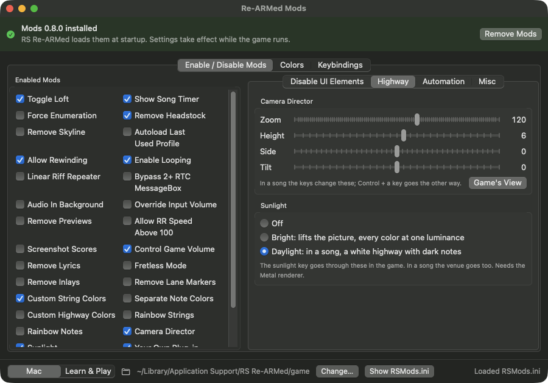

# rearmed-mods

[RSMods](https://github.com/Lovrom8/RSMods) for **RS Re-ARMed**, the native Apple Silicon port of Rocksmith 2014, and
some mods of its own. One library for both of RS Re-ARMed's apps, RS Re-ARMed and RS Re-ARMed Learn & Play, and a Mac app
to install and set it up.

RSMods, "the Rocksmith Mods that nobody asked for", is a mod collection for the Windows version of Rocksmith
2014 Remastered, made by LovroM8 and Ffio1 with help from ZagatoZee, Kokolihapihvi and L0fka. rearmed-mods brings
many of its features to [RS Re-ARMed](https://github.com/bbelgg/rs-rearmed) on macOS: the same features, the same
`RSMods.ini` settings and the same default keys, rewritten for the Mac build of the game.

All credit for the ideas, the features and their design goes to the RSMods team. This is an independent port:
not made or endorsed by the RSMods team, and not affiliated with Ubisoft. Rocksmith is a trademark of Ubisoft.



## Table of Contents

- [Requirements](#requirements)
- [Install](#install)
- [Settings](#settings)
- [Mods](#mods)
- [Not on macOS yet](#not-on-macos-yet)
- [Built into RS Re-ARMed](#built-into-rs-re-armed)
- [How it works](#how-it-works)
- [Troubleshooting](#troubleshooting)
- [Building and developing](#building-and-developing)
- [Credits](#credits)
- [License](#license)

## Requirements

- An Apple Silicon Mac with **RS Re-ARMed 1.5.1 or later** installed. The library is built on what 1.5.1 brought, the
  game's functions and data by name, so one file runs on both editions. With an older version it doesn't load.
- The string, note and highway colors need RS Re-ARMed 1.9.0, which has the game's color table by name
  and the render API, and the note and highway colors need its Metal renderer. Without them those mods stay off and the
  rest works. Sunlight needs the Metal renderer too.
- macOS 13 or later for the app.
- To build from source: the Xcode command line tools (`xcode-select --install`), with Swift 5.9 or later.

rearmed-mods doesn't change the game or RS Re-ARMed: it is one library in each edition's mods folder. Delete it and the game
is as before.

## Install

1. Download `Re-ARMed-Mods-<version>.zip` from the [Releases](https://github.com/glebb/rearmed-mods/releases) page
   and open it; you get **Re-ARMed Mods.app**. Move it to Applications.
2. Open it. The first time, macOS says it can't verify the developer: the app isn't notarized by Apple. Go to
   **System Settings › Privacy & Security**, scroll down, click **Open Anyway** next to Re-ARMed Mods, and
   confirm. (On older macOS: right-click the app, choose **Open**, then **Open** again.)
3. Quit RS Re-ARMed if it's running, and click **Install Mods** at the top of the app's window.
4. Start RS Re-ARMed as usual, and turn mods on in the app.

The app carries the mods library and copies it into `~/Library/Application Support/RS Re-ARMed/mods/`, and
`RS Re-ARMed/learn-play/mods/` if Learn & Play is installed, which the game loads at startup (it removes the download's quarantine flag from that copy, so only the app itself needs
**Open Anyway**). It checks that RS Re-ARMed is installed and new enough. When you download a newer version of
the app, it offers **Update Mods**; **Remove Mods** takes the library out again. A reinstall of RS Re-ARMed keeps
the mods folder.

On its first start with the mods, the game creates `RSMods.ini` in its game folder
(`~/Library/Application Support/RS Re-ARMed/game/`, `learn-play/game/` for Learn & Play) with every mod off.

### From source

```bash
git clone https://github.com/glebb/rearmed-mods.git
cd rearmed-mods
./build.sh --install      # the library only, into the mods folders (quit the game first)
gui/build-app.sh --open   # the app, with the library inside
```

To uninstall, remove the mods in the app (or delete `rearmed-mods.dylib` from the mods folders), then delete the app
and, if you like, `RSMods.ini` in the game folder.

## Settings

The settings are in `RSMods.ini` in the game folder, one for each edition: the same sections (`[Toggle Switches]`,
`[Mod Settings]`, `[Keybinds]`, `[Audio Keybindings]`, `[String Colors]`, `[Highway Colors]`) and keys as RSMods on
Windows, so an `RSMods.ini` from Windows works too.
The mods re-read the file while the game runs: a change takes effect within a second, no restart.

**Re-ARMed Mods.app** (in `gui/`) edits it like the Windows RSMods GUI: an **Enable / Disable Mods** tab with each mod's
settings, a **Colors** tab and a **Keybindings** tab (click a key field, press a key). The switch at the bottom left goes
between the two editions' settings. Or edit the file in any text editor.

Keys are letters, digits, `F1`-`F20` or Windows `VK_` names (as RSMods writes them), mapped to the Mac keys.
Function keys may need **Fn** on a Mac keyboard. Where RSMods uses Ctrl + a key (for example to lower a value),
it's the Control key.

## Mods

What each mod does, its settings, and how it differs from RSMods on Windows.

* **Allow Riff Repeater Speed Above 100%**
  * In a song, the speed key raises the song speed by `RRSpeedInterval` percent; Control + the key lowers it
    (6.25% to 400%). The speed shows at the top of the screen and, after each change, in
    `riff_repeater_speed.txt` in the game folder, for stream overlays.
  * `[Toggle Switches] RRSpeedAboveOneHundred`, `[Mod Settings] RRSpeedInterval` (2), `[Keybinds] RRSpeedKey` (R)

* **Linear Riff Repeater**
  * The Riff Repeater slider's percent is the song speed: 68% plays at 68%, not at about 50%.
  * `LinearRiffRepeater`

* **Enable Looping**
  * In Learn a Song and Non-Stop Play, the loop start key sets the loop's start at the song position and the
    loop end key its end; past the end the song goes back to the start, `LoopingLeadUp` ms early. The loop shows
    at the top. Control + loop start clears the loop, Control + loop end clears its end. Leaving the song or
    opening Riff Repeater clears it.
  * `AllowLooping`, `[Mod Settings] LoopingLeadUp` (0), `[Keybinds] LoopStartKey` (Y), `LoopEndKey` (U)
  * Different: RSMods also resets the game's "grey note" time while paused in a loop, so notes in the loop stay
    active. Not on macOS yet: after a pause, notes you already passed may stay grey.

* **Allow Rewinding**
  * The rewind key moves the song back `RewindBy` + `RewindLeadup` ms.
  * `AllowRewind`, `[Mod Settings] RewindBy` (5000), `RewindLeadup` (2000), `[Keybinds] RewindKey` (Z)
  * Different: the "grey note" reset is not on macOS yet, as with looping.

* **Show Song Timer**
  * The song position at the top right: in every song (`ShowSongTimerWhen = automatic`) or shown and hidden with
    the key (`manual`, the key works in both).
  * `ShowSongTimer`, `ShowSongTimerWhen` (manual), `[Keybinds] ShowSongTimerKey` (I)
  * Different: the position comes from the game's audio engine. It appears once the song's audio plays, a few
    seconds in.

* **Control Game Volume**
  * Each channel's key raises its volume by `VolumeControlInterval`, Control + the key lowers it; the changed
    channel shows at the top left. Hold the mixer key to see every channel. The mute keys mute and unmute player
    1 and 2 (they work with this mod off too).
  * `VolumeControl`, `[Mod Settings] VolumeControlInterval` (5), `[Audio Keybindings]`: master 5, song 6,
    player 1 7, player 2 8, microphone 9, voice-over 0, SFX S, mixer P, mute player 1 X, mute player 2 C,
    change selected volume B
  * Different: the changed channel's volume hides again after 3 seconds.

* **Remove Song Previews**
  * No previews while you browse the song lists.
  * `SongPreviews`

* **Autoload Last Used Profile**
  * At startup the game goes straight into the profile at the top of the list (the last used one).
  * `ForceProfileLoad`
  * Different: `ProfileToLoad` (a named profile) is not on macOS yet; the top profile is entered.

* **Force ReEnumeration**
  * The game finds songs you added without a restart: with the key (`manual`) or automatically when the number of
    files under `dlc/` changes (`automatic`, checked every `CheckForNewSongsInterval` ms).
  * `ForceReEnumeration` (off / manual / automatic), `[Mod Settings] CheckForNewSongsInterval` (5000),
    `[Keybinds] ForceReEnumerationKey` (F)
  * Different: RSMods' "Enumerate" entry in the main menu is not a mod here: [RS Re-ARMed has it](#built-into-rs-re-armed).

* **Override Input Volume**
  * Keeps an input device, such as the Real Tone cable, at `OverrideInputVolume` percent (17 is the game's
    default), checked every 2 seconds.
  * `OverrideInputVolumeEnabled`, `OverrideInputVolumeDevice`, `[Mod Settings] OverrideInputVolume` (17)
  * Different: the device is part of its name as macOS shows it (Audio MIDI Setup), e.g.
    `Rocksmith USB Guitar Adapter`; empty means the default input. Not in RSMods: several devices, separated by
    `;`, each optionally with its own percent:
    `OverrideInputVolumeDevice = Rocksmith USB Guitar Adapter; Rocksmith Game (OBS) = 100`.

* **Screenshot Scores**
  * 8 seconds after a score screen opens (Learn a Song, Score Attack, Duet, Head-to-Head), the screen is saved.
  * `ScreenShotScores`
  * Different: RSMods presses F12 for a Steam screenshot. RS Re-ARMed runs without the Steam client, so the mod
    saves the picture itself, as a PNG in `~/Pictures/RS Re-ARMed/` (`<song key> <date> <time>.png`).

* **Bypass 2+ Real Tone Cable Popup**
  * No popup when two Real Tone cables are connected.
  * `BypassTwoRTCMessageBox`
  * Different: the game may still show its warning as a notification for 10 seconds.

* **Play Audio In Background**
  * The song keeps playing, with sound, while another app is active.
  * `AllowAudioInBackground`

* **Toggle Loft**
  * The venue behind the note highway goes black, for example to key it out in OBS with a Luma Key, as on
    Windows (see RSMods' FAQ). Turn off Venue Mode in the game's settings too.
  * `ToggleLoft`, `ToggleLoftWhen` (manual: the key; song: in songs; startup: always),
    `[Keybinds] ToggleLoftKey` (T)
  * Different: besides the loft camera that RSMods changes, the Mac build draws the song's backdrop, the venue's
    props and floor, and your tone's amps and cabinets separately; they are all hidden, with the surface under the
    strings (the guitar's fret board and neck) and, in a song, the haze around the strings. In lessons (Guided
    Experience) the loft stays, as in RSMods. Gear the game adds while the loft is off (a tone change) disappears
    within 15 seconds. RSMods' green screen wall is not on macOS yet.

* **Remove Headstock**
  * Hides the headstock and tuning pegs, in songs (`song`) or everywhere (`startup`).
  * `Headstock`, `RemoveHeadstockWhen` (song)

* **Remove Skyline**
  * Hides the phrase bars (dynamic difficulty) at the top of the screen, in songs or everywhere.
  * `Skyline`, `ToggleSkylineWhen` (song)

* **Remove Lyrics**
  * Hides the lyrics, with the key (`manual`) or always (`startup`).
  * `Lyrics`, `RemoveLyricsWhen` (manual), `[Keybinds] RemoveLyricsKey` (L)

* **Fretless Mode / Remove Inlays / Remove Lane Markers**
  * Hide the fret wires, the position dots on the neck, and the lane lines on the highway.
  * `Fretless`, `Inlays`, `LaneMarkers`

* **Custom String Colors**
  * The strings and what the game makes from them (glow, inactive, tuning pegs, text), for normal and colorblind
    mode. The notes follow unless they have their own colors.
  * `CustomStringColors = 2`, `[String Colors]` `string0_N` to `string5_N`, `string0_CB` to `string5_CB` (RRGGBB)
  * Different: the two note body colors are what RSMods' color tables give; on Windows a lookup by the wrong name
    makes them red.

* **Separate Note Colors**
  * The notes get their own colors.
  * `SeparateNoteColors = on` with `[Mod Settings] SeparateNoteColorsMode = 2`, `[String Colors]` `note0_N` and so on

* **Rainbow Strings / Rainbow Notes**
  * The key turns it on and off: a turn of the colors in about three seconds. Rainbow notes work in a song.
  * `RainbowStrings`, `RainbowNotes`, `[Keybinds] RainbowStringsKey` (V), `RainbowNotesKey` (N)

* **Custom Highway Colors**
  * The lanes (numbered and unnumbered go together), gutters and fret numbers. A color left empty stays the game's.
  * `[Highway Colors]` `CustomHighwayColors`, `CustomHighwayNumbered`, `CustomHighwayUnNumbered`, `CustomHighwayGutter`,
    `CustomFretNubmers` (spelled so on Windows too)

* **Camera Director** (not in RSMods)
  * Your own view of the note highway. In a song the keys zoom it, raise the camera, move it sideways and tilt it,
    Control + key the other way, and the reset key goes back to the game's view. The game's camera still follows the
    song and the stage stays where it is. Two players are untested.
  * `CameraDirector`, `[Mod Settings]` `CameraZoom` (100; 60 to 160), `CameraHeight` (0; -10 to 20), `CameraSide` (0; -20 to
    20), `CameraTilt` (0; -15 to 15), `[Keybinds]` `CameraZoomKey` (K), `CameraHeightKey` (H), `CameraSideKey` (D),
    `CameraTiltKey` (M), `CameraResetKey` (J)

* **Sunlight** (not in RSMods)
  * For a screen outdoors. The key goes through off, bright and daylight. Bright lifts the picture and brings every
    color up to one luminance. Daylight, in a song, turns it over: a white highway with dark notes, as dark on white
    stays readable in the sun. In the menus daylight is bright. In a song the venue goes too, as with the loft off.
  * `Sunlight`, `[Mod Settings] SunlightMode` (1; 0, 1 or 2), `[Keybinds] SunlightKey` (G)
  * The picture is changed by a filter on the game's window, so it needs no new RS Re-ARMed, and screenshots from the
    mods show the frame before it. Checked in the Mac edition, in a window and in full screen; not yet in Learn & Play.

* **Your Own Plug-in (ToneHost)** (not in RSMods)
  * `rs-tonehost`, an add-on in [`tonehost`](tonehost/README.md), plays the guitar through an Audio Unit, such as Helix
    Native, and follows the game's tones. The game starts the host, and the game's guitar is silent while it runs; the
    guitar fader and the volume keys still work. Without the host the game keeps its tones. It is built from source and
    isn't in the app: set it up from that folder.
  * `ToneHost`

The hiding mods (loft, headstock, skyline, lyrics, frets, inlays, lane markers) find what they hide in the game's
memory after each scene loads. It takes a second or two after a song starts.

## Not on macOS yet

From RSMods, not ported yet:

- Extended Range Mode and its ZZ string colors
- Green Screen Wall, Remove Fingerprints
- GuitarSpeak, Show Current Note, Show Current Accuracy
- Custom Song List Titles and the extra song lists
- Custom Non-Stop Play timer
- Prevent Buggy Tones, Alternative Sample Rates
- Auto Tune For Song (MIDI pedals)
- Start Rocksmith on a secondary monitor
- `ProfileToLoad` (auto load a named profile) and the "grey note" reset of looping and rewinding
- RSMods' file tools: Custom Tunings, the default tones, profile backups

Not planned: what only exists on Windows (Twitch and Crowd Control integrations, the Oculus crash fix, ASIO).

## Built into RS Re-ARMed

These RSMods features need no mod, as RS Re-ARMed has them itself, on both editions and with no change to your game files:

- **Fast Load**: the game starts with no intro screens.
- **Enumerate**: ENUMERATE in the main menu, in place of SHOP, adds new songs with no restart.
- **Exit Game**: EXIT GAME in the main menu, in place of UPLAY. From RS Re-ARMed 1.9.0, with **Refresh
  Game Files** after updating.
- **Direct Connect Mode**: DIRECT CONNECT in the INPUT setting and on the cable screen, for any audio interface.

## How it works

RSMods on Windows patches the 32-bit Windows executable at fixed addresses and changes Direct3D 9 draws. RS
Re-ARMed has no original machine code at run time: the game is translated to C and compiled for arm64. So rearmed-mods
works from what RS Re-ARMed gives mods, and has no address of a game, which is why one file runs on both editions:

- **Hook points**, by name: the library runs code before and after some game functions (each frame, key events, Wwise
  audio events, the game's focus, the camera frustum, the Riff Repeater speed conversion, the two-cable check).
- **The game's own functions and data**, by name: Wwise for speed, volume, seeking and the song position, the UI manager
  for the current menu, the DLC coordinator for enumeration, the color manager for string colors.
- **Hiding parts of the picture**: the game's Gamebryo scene objects and render steps are found by name in memory (from
  their run-time type information) and culled, collapsed or switched off.
- **The overlay API** for text on screen and reading the frame, and **the render API** for note and highway colors.
- macOS APIs where Windows ones were used: Core Audio (input volume), ImageIO (screenshots), Core Image (Sunlight).

More in [docs/how-it-works.md](docs/how-it-works.md).

## Troubleshooting

Logging: before starting the game, `launchctl setenv RS_MODS_LOG 1` (and `launchctl unsetenv RS_MODS_LOG` to stop).
The mods then write what they do to `~/Library/Application Support/RS Re-ARMed/logs/last-run.log`: menus, song
keys, key presses, what each mod changes.

`RS_LOAD_MODS=0` (with `launchctl setenv`) starts RS Re-ARMed without any mods.

For finding what a mod should hook or hide. None of these are in the app; all are off unless set by hand:

| Setting | What it does |
|---|---|
| `[Keybinds] SceneDumpKey` | Writes every scene object and render step, with its class and name, to `scene-dump.txt` in the game folder. |
| `[Toggle Switches] HideNodes` | Scene objects to hide, comma separated (`name*` matches a prefix). |
| `[Toggle Switches] HideSteps` | Render steps to switch off, comma separated. |
| `[Keybinds] HideNodesKey` | Turns `HideNodes` and `HideSteps` off and on. |
| `[Mod Settings] LoftExtraFar` | Camera far planes the loft cuts besides 10000, comma separated. |

## Building and developing

```
build.sh                 builds build/rearmed-mods.dylib (--install: into RS Re-ARMed's mods folders)
VERSION                  the library's and the app's version
src/rsmods.c, .h         the core: hooks, game state, Wwise calls, the mod list
src/rsmods_ini.c         RSMods.ini (defaults, key names)
src/rsmods_overlay.c     text over the game
src/rsmods_scene.c       the scene graph and render steps: finding and hiding by name, the dump
src/mod_*.c              one file per mod
include/rs-rearmed/      RS Re-ARMed's runtime headers (MIT)
gui/                     Re-ARMed Mods.app: settings and installer (SwiftUI); build-app.sh --zip makes the release
tonehost/                rs-tonehost: the add-on that hosts your own plug-in, and its Helix Native setup
docs/how-it-works.md     how the library works with RS Re-ARMed
```

A mod is an `rsm_mod` (`rsmods.h`): a tick each frame, key events, song changes, Wwise event filtering. Key events don't
reach the mods while the player types: in a text entry dialog, or in the song search, until Esc or another screen
(`typing` in `rsmods.c`). Add a mod to `MODS` in `rsmods.c`, its defaults to `DEFAULT_INI` and `DEFAULTS` in
`rsmods_ini.c`, and to the settings app's `gui/Sources/RSModsMac/Catalog.swift`. A mod that needs a new hook point needs it
in RS Re-ARMed's `tools/targets/names/hooks.list` and a new RS Re-ARMed release. So does a new function, global or field:
a name in `tools/targets/names`, and an entry in each game's table.

The library has no address or offset of a game, so the same file runs on both (`rc_mod.h`): `rsm_hook("name", ...)` for a
hook point, `OV_GUEST(name, ...)` for a call, `RC_OFF(name)` for a field, `rc_mod_ptr` for a pointer in the game's memory,
whose size differs, and memory from `rc_guest_alloc` for what a game function reads or fills. What a game lacks is logged
and its mod stays off.

### Tests

```bash
./test.sh
```

runs the library's tests (`tests/`: `RSMods.ini`, key names, Sunlight's colors) and the app's (`gui/Tests`: settings, install
and update for both editions). None needs the game. They also check the app against `src/rsmods_ini.c`: the same defaults,
the same key names, and no two actions on one default key. A mod's work in the game is checked by playing it.

## Credits

- [RSMods](https://github.com/Lovrom8/RSMods) by LovroM8 and Ffio1, with ZagatoZee, Kokolihapihvi, L0fka and
  everyone who contributed: the features, their design, the settings and the default keys.
- [RS Re-ARMed](https://github.com/bbelgg/rs-rearmed): the Mac build these mods run in, and its runtime headers in
  `include/rs-rearmed` (MIT).

## License

[MIT](LICENSE), for this project's own code. `include/rs-rearmed` is RS Re-ARMed's, under its own MIT license. RSMods has no
license file, and this license gives no rights to RSMods itself.
